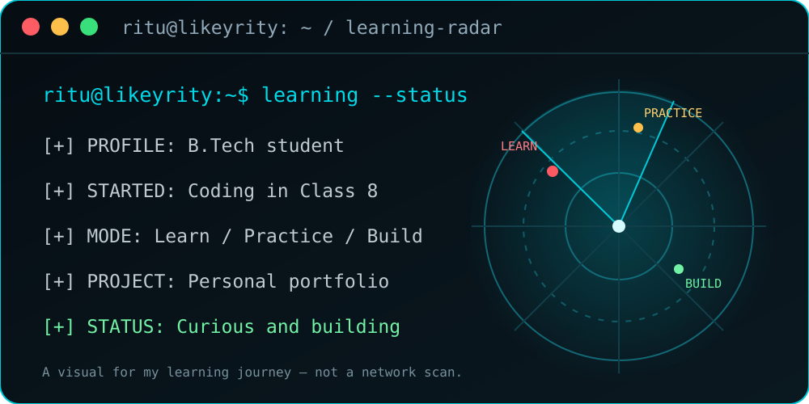

### B.Tech student · Curious learner · Building one project at a time

## 👋 About me

I started coding in Class 8, and that early curiosity grew into a lasting interest in technology. I’m now pursuing a B.Tech degree and learning by building, experimenting, and improving step by step.

## 🚀 My learning journey

- 🎓 B.Tech college student
- 💻 My coding journey began in Class 8
- 🌱 Learning through practice and personal projects
- 🚀 Current featured project: [My portfolio](https://likeyritu.github.io/ritu-raj-portfolio/)

I’m building a foundation in engineering and software development, then putting each new idea into practice through projects. I’m interested in how technology works and how small experiments can become useful things people can use.

## 🧰 Tools behind my portfolio

React · TypeScript · Tailwind CSS · Vite

## 🛰️ Learning radar

A snapshot of my learning journey: learn, practice, and build.

## 📊 GitHub activity

## 📫 Connect with me

- 🌐 [Portfolio](https://likeyritu.github.io/ritu-raj-portfolio/)
- 📸 [Instagram](https://www.instagram.com/rajsing_az/)
